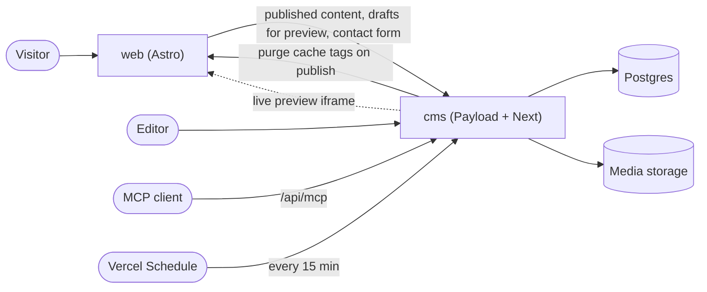

# Minimal Portfolio

A photography portfolio built with [Payload CMS](https://payloadcms.com) and [Astro](https://astro.build). It is the owner's real site, and it doubles as a worked example of what Payload can do for a small editorial site:

- **Live preview**: the admin shows the public page next to the form and updates it as you type, without saving.
- **Drafts, autosave and versions**: projects and the profile stay drafts until published, with a version history.
- **Scheduled publishing**: pick a date and a project goes live on its own.
- **Localization**: Italian (default, at `/`) and English (at `/en`), with English falling back to Italian.
- **Form builder**: the contact form is a Payload form, and submissions are stored in the CMS.
- **MCP**: an MCP endpoint lets an AI client such as Claude Code read content and draft changes.

The public site is plain Astro with no UI framework: server-rendered pages, cached on the CDN and purged by tag when content is published. The homepage hero is an ASCII skyline (a brutalist block and Berlin's TV tower) drawn by a WebGL shader. The admin and API live in a separate Payload app.

**Live site:** https://minimal-portfolio-murex-one.vercel.app | **Admin:** https://minimal-portfolio-cms.vercel.app/admin

<video src="docs/media/editing-demo.webm" controls muted width="800"></video>

If the video does not play in your viewer, open [docs/media/editing-demo.webm](docs/media/editing-demo.webm). It shows editing a project, autosave, version history and the schedule dialog, which the demo account cannot use.

## Architecture

A pnpm monorepo with two deployable apps and one shared package.

| Path              | What                                                                            |
| ----------------- | ------------------------------------------------------------------------------- |
| `apps/cms`        | Payload 3 on Next.js 16: admin, REST API, MCP endpoint, Postgres, media storage |
| `apps/web`        | Astro 7 (`output: 'server'`, Vercel adapter): the public site                   |
| `packages/shared` | Code both apps need, such as the live-preview token                             |



- **Data**: Postgres through `@payloadcms/db-postgres`. Locally it is PGlite, in production Neon. Schema changes are committed migrations (`apps/cms/src/migrations`), applied by `pnpm --filter cms migrate` and by every `cms` build.
- **Media**: Vercel Blob when `BLOB_READ_WRITE_TOKEN` is set, otherwise files in `apps/cms/media/`. Media is public, so its URLs point straight at the Blob CDN and no function runs to serve a file.
- **Caching**: pages set cache tags through Astro route caching on Vercel's CDN, from the page files (Astro only lets pages change the response). On publish, the CMS calls `web` at `/api/revalidate` (bearer `REVALIDATE_SECRET`) and the affected tags are purged.
- **Scheduled publishing**: on Vercel, a Vercel Schedule (`apps/cms/vercel.json`) calls `/api/payload-jobs/run` every 15 minutes. Anywhere else, the CMS polls its own job queue every minute.
- **Roles**: `owner` (everything), `demo` (the public, read-only login), and two API-key service users: `preview` (lets `web` read drafts for live preview) and `submitter` (lets `web` post contact form submissions).

More detail: [docs/architecture.md](docs/architecture.md) explains each part (the demo guard, caching and purge, live preview, scheduling, the contact form, MCP), and [docs/process.md](docs/process.md) describes how the project was planned, built and reviewed.

## Try the demo

Open https://minimal-portfolio-cms.vercel.app/admin and sign in with:

- Email: `<demo email>`
- Password: `<demo password>`

The demo account can explore the whole admin, open any project, edit fields and use live preview. It never saves or uploads anything: Save and Publish show a notice, autosave is rejected silently, and a reload brings back the original content. Users, form submissions and API keys are hidden from it, and the schedule control is visible but disabled.

## Live preview

Open a project (or the Profile) in the admin and click Live Preview. Type in a field and the preview pane re-renders the real page, in the language you are editing, from the unsaved form state. Mobile, tablet and desktop widths are available. The public site is not touched: visitors keep seeing the published version. It works for the demo account too, since nothing needs to be saved.

The preview pane is an iframe of a `web` route (`/preview/...`). Its URL carries a token, signed with `PREVIEW_SECRET`, for exactly that document and locale, so `web` needs no admin cookies.

## Connect Claude Code over MCP

The CMS serves MCP at `/api/mcp` (through `@payloadcms/plugin-mcp`). Clients can find, create and update projects and the profile, and edit the details of uploaded images and videos (new media is uploaded in the admin). Nothing can be deleted. Tools run with the key owner's access rules. The tool descriptions ask the client to save drafts (`draft: true`) so the owner reviews changes before publishing, but a client that leaves it out publishes directly: only tick the tools you trust the client with.

API keys are created by the owner in the admin (the MCP API Keys collection, visible to the owner only). Each key has per-tool checkboxes, which are off by default: tick only what the client needs.

```sh
claude mcp add --transport http portfolio https://minimal-portfolio-cms.vercel.app/api/mcp --header "Authorization: Bearer <MCP_API_KEY>"
```

`<MCP_API_KEY>` is the value shown when the owner creates the key. It is not an environment variable of this repo.

## Local setup

Requires Node.js 26 (`.nvmrc`) and [pnpm](https://pnpm.io) (`corepack enable` picks up the pinned version).

```sh
pnpm install
pnpm dev
```

`pnpm dev` starts an embedded Postgres (PGlite, data in `.pglite/`), applies the migrations, seeds sample content and the accounts, and starts both apps. No Docker and no account needed.

- Site: http://localhost:4321
- Admin: http://localhost:3000/admin. Owner login `owner@example.com` / `local-owner-password`, demo login `demo@example.com` / `local-demo-password`. These are the local placeholders from `.env.example`.

With no `.env`, the scripts use `.env.example`; copy it to `.env` to change values. To see the site with the live content instead, run only the site against the production CMS: `CMS_URL=https://minimal-portfolio-cms.vercel.app pnpm --filter web dev`.

If every local page takes about 8 seconds, check that `/etc/hosts` has a plain `127.0.0.1 localhost` line: when `localhost` is slow to resolve, the site's requests to the CMS hit their 8-second timeout. If you would rather use a real Postgres, `docker compose up -d` serves Postgres 17 on the same URL, and `pnpm dev:apps` starts the apps without PGlite.

### Tests

```sh
pnpm --filter cms test:int   # Payload integration tests, in their own schema of the local database (start it with `pnpm db`)
pnpm --filter cms test:e2e   # Playwright, on its own stack and database (ports 3300, 4400, 5532); runs next to an open `pnpm dev`
pnpm --filter web test       # Vitest unit tests
```

Playwright needs a browser once: `pnpm --filter cms exec playwright install chromium`. To regenerate the recording in `docs/media/`, run `pnpm --filter cms record:demo`; it is not part of `test:e2e`.

## Environment variables

All of them are in `.env.example`, whose values work as they are for local development. On Vercel, set them in each project's settings (the table says which app reads what).

| Variable                          | Read by  | Purpose                                                                                                                                         |
| --------------------------------- | -------- | ----------------------------------------------------------------------------------------------------------------------------------------------- |
| `DATABASE_URL`                    | cms      | Postgres connection string. Production: Neon's pooled URL.                                                                                      |
| `PGLITE_PORT`                     | scripts  | Port of the local PGlite server (default 5432).                                                                                                 |
| `PGLITE_DATA_DIR`                 | scripts  | Data directory of the local PGlite server (default `.pglite`).                                                                                  |
| `PAYLOAD_SECRET`                  | cms      | Payload's signing secret. Use a long random string in production.                                                                               |
| `OWNER_EMAIL`, `OWNER_PASSWORD`   | seed     | The owner account the seed creates.                                                                                                             |
| `DEMO_EMAIL`, `DEMO_PASSWORD`     | seed     | The read-only demo account the seed creates. Skipped if either is empty.                                                                        |
| `PREVIEW_API_KEY`                 | seed, web | API key of the `preview` service user (the seed creates the user). `web` sends it to read drafts for live preview.                             |
| `SUBMITTER_API_KEY`               | seed, web | API key of the `submitter` service user. `web` sends it to post contact form submissions.                                                      |
| `PREVIEW_SECRET`                  | cms, web | Signs and verifies live-preview tokens.                                                                                                         |
| `REVALIDATE_SECRET`               | cms, web | Bearer secret of the cache-purge endpoint on `web`.                                                                                             |
| `CRON_SECRET`                     | cms      | Must be set on Vercel. Vercel sends it as a bearer token on scheduled calls, and the CMS refuses job runs without a match, so scheduled publishing does not run if it is missing. |
| `CONTACT_FORM_SECRET`             | web      | Signs the contact form's render timestamp and salts the stored IP hash. Use a long random string in production.                                 |
| `VERCEL_AUTOMATION_BYPASS_SECRET` | cms, web | Production only. Sent as `x-vercel-protection-bypass` on calls between the two projects, so they get through Vercel Authentication.            |
| `BLOB_READ_WRITE_TOKEN`           | cms      | Vercel Blob token. Empty locally: media goes to `apps/cms/media/`.                                                                              |
| `CMS_URL`                         | cms, web | Public URL of the CMS (default `http://localhost:3000`).                                                                                        |
| `WEB_URL`                         | cms, web | Public URL of the site (default `http://localhost:4321`).                                                                                       |

Never commit real values: `.env*` is git-ignored except `.env.example`.

## Production setup

Deployment is two Vercel projects from this repo. The build settings are in `apps/cms/vercel.json` and `apps/web/vercel.json`; the rest is dashboard work, done by the owner.

1. **Projects and domains**: create two projects from the repository, with Root Directory `apps/cms` and `apps/web`. Keep "Include source files outside of the Root Directory" on, so `packages/shared` is available, and turn on skipping deployments for unaffected projects. Attach the domains, then set `CMS_URL` and `WEB_URL` to them in both projects. Both `vercel.json` files pin the functions to `fra1`; change it to the region of your database.
2. **Database**: add Neon from the Vercel Marketplace to the `cms` project, with preview branching on so each preview deployment gets its own branch. Use the pooled URL as `DATABASE_URL`. Every `cms` build runs the migrations against it.
3. **Media**: create a **public** Blob store and connect it to `cms`. The Payload adapter needs a read-write token (`vercel_blob_rw_…`): newer stores connect through OIDC and only set `BLOB_STORE_ID`, so copy the store's read-write token into `BLOB_READ_WRITE_TOKEN` yourself. A private store does not work with the adapter.
4. **Secrets**: set every variable in the table above, with long random values for the secrets. `CRON_SECRET` must be set on `cms`. `PREVIEW_SECRET`, `REVALIDATE_SECRET`, `PREVIEW_API_KEY` and `SUBMITTER_API_KEY` must have the same value in both projects.
5. **Protection Bypass for Automation**: enable it in both projects and set `VERCEL_AUTOMATION_BYPASS_SECRET` to the same value in both, so server-to-server calls pass Vercel Authentication.
6. **Rate-limit the login**: in the `cms` project's Vercel Firewall, add one rate-limit rule for `POST` requests to `/api/users/login`, which the admin signs in through, and `/api/graphql`, which also offers a login mutation (for example 10 per minute per IP, then deny). Account lockout is off (`maxLoginAttempts: 0`) so nobody can lock the public demo account, which makes this rule the only brute-force protection, owner account included.
7. **Seed**: before sharing the CMS URL, run the seed once against the production database: `pnpm --filter cms seed`, with the production values of `DATABASE_URL`, `PAYLOAD_SECRET`, `BLOB_READ_WRITE_TOKEN`, `OWNER_EMAIL`, `OWNER_PASSWORD`, `DEMO_EMAIL`, `DEMO_PASSWORD`, `PREVIEW_API_KEY` and `SUBMITTER_API_KEY` exported in your shell (shell values win over `.env`). If you keep them in a file and `source` it, quote each value: the Neon URL contains `&`. It creates the owner first, and the other accounts only once an owner exists. Accounts that already exist are left alone. It also creates the sample projects, which you can unpublish or replace. Against a remote database the seed refuses to run while any password or API key still has its `.env.example` value, and on Vercel the scripts never fall back to `.env.example`.
8. **Check**: the site renders, the admin loads, the demo login works and live preview shows the page. Check live preview on the production domains: on a protected preview deployment, the editor would also need to be signed in to Vercel.

Preview deployments of the two projects are not linked to each other automatically; a `web` preview reads from whatever `CMS_URL` is set to. A `cms` preview runs the migrations against its own `DATABASE_URL`, so keep Neon's preview branching on, or previews migrate the production database.

## Media credits

Sample photos and clips are credited in [apps/cms/src/seed/media/CREDITS.md](apps/cms/src/seed/media/CREDITS.md).

## License

Code is released under the [MIT License](LICENSE). The sample photos and clips keep their own licences (see the credits) and are not covered by the MIT License.
