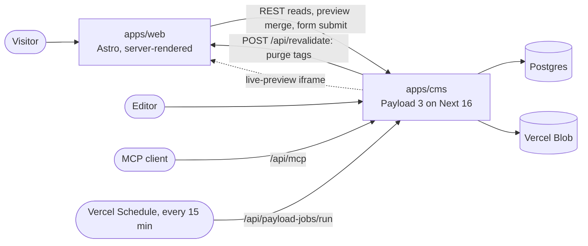

# Architecture

How the pieces of this repo fit together, and why they are built the way they are. For setup and deployment, see the [README](../README.md).

## The parts

| Path | Role |
| --- | --- |
| `apps/cms` | Payload: admin UI, REST/GraphQL API, MCP endpoint, jobs, migrations, seed. The only thing that talks to the database and the media store. |
| `apps/web` | The public site. Astro with `output: 'server'` and the Vercel adapter, no UI framework. Reads published content from the CMS over REST. |
| `packages/shared` | Code both apps must agree on: cache-tag names and the live-preview token (HMAC-SHA256 via Web Crypto, so it runs in Node and at the edge). |
| `scripts/` | Local tooling: the PGlite server, the dev orchestrator and the env loader. |

The two apps deploy as two Vercel projects from the same repo and only know each other through `CMS_URL` and `WEB_URL`.

## Content model

- **Projects** (drafts, autosave, versions, scheduled publish): a title, client, role, date and credits, plus `items`, an ordered list of photo and video blocks that reference media by id. The first item is the cover on the homepage and in the portfolio list. `featured` and `order` decide the homepage and the sort order.
- **Images** and **Videos**: upload collections. Images get responsive sizes from 640 to 2560 px wide, and videos can carry a WebM and an MP4 file plus a poster.
- **Profile** (a global, with drafts): name, role, bio, portrait, homepage hero, client marquee and contact details.
- **Forms** and **form submissions**, from `@payloadcms/plugin-form-builder`: the contact form's fields are content too.
- **Localization**: Italian is the default and English falls back to it. The site serves Italian at `/` and English at `/en`.

## Roles and the demo guard

Four roles, assigned only by the seed (`context.assignRole`). No API path can set or change a role, the first-user registration included.

| Role | Who | Can |
| --- | --- | --- |
| `owner` | the site owner | everything |
| `demo` | the public demo login | open everything, edit fields, use live preview, save nothing |
| `preview` | an API-key user for `apps/web` | read drafts, for live preview |
| `submitter` | an API-key user for `apps/web` | create form submissions, read the contact rate counter |

The demo must be able to explore the whole admin, so hiding buttons would not be enough: any write has to fail on the server. `apps/cms/src/plugins/demo-guard` does this in three layers:

1. **Collection and global hooks.** A `beforeOperation` hook on every collection and global rejects create, update, delete and upload operations from `demo` and `preview`, with a friendly message. The plugin is registered last (`order: 100`), so it also wraps the collections other plugins add: forms, submissions, MCP keys and jobs. The demo keeps `update` access on content, because without it Payload renders fields read-only and live preview has nothing to send.
2. **The proxy** (`apps/cms/src/proxy.ts`, Next 16's renamed middleware). Payload writes admin preferences straight to the database without hooks, so the proxy bounds them before they reach Payload: an allow-list of keys, 16 KB per value, per-document keys acknowledged but not stored, and GraphQL bodies parsed so the decoded query is checked for preference mutations. It matches the decoded path, because Payload routes on the decoded path and an encoded one would otherwise get past it.
3. **The admin UI.** Save and Publish show a "demo mode" notice instead of an error, autosave fails silently, the schedule button is visible but disabled, and a banner explains what the account is. This is presentation only; layers 1 and 2 are what enforce it.

Document locking is off everywhere (`lockDocuments: false`), since a lock row is itself a write and the shared demo login would lock documents for everyone.

The integration tests in `apps/cms/tests/int/demo-guard.int.spec.ts` act as the demo user against projects, globals, versions, uploads, the jobs queue, users and preferences. They also cover GraphQL with escaped mutation names and encoded paths, and check that the owner is unaffected. One test checks that every collection in the config has a preference entry, so a new collection cannot be left out of the allow-list silently.

## Rendering and caching

Every page is server-rendered on request and cached on Vercel's CDN through Astro's route cache (`cacheVercel()`), for up to 3 hours plus 60 seconds stale-while-revalidate. Each response declares tags (`packages/shared/src/cache-tags.ts`):

| Page | Tags |
| --- | --- |
| Home | `featured`, `layout`, `locale:<l>`, plus each shown media item |
| Portfolio | `portfolio`, `layout`, `locale:<l>`, plus media |
| Project | `project:<id>`, `layout`, `locale:<l>`, plus media |
| Info | not cached: the contact form carries a fresh signed timestamp |

**Purge on publish.** CMS hooks (`apps/cms/src/hooks/purge.ts`) compute which tags a change affects and call `POST /api/revalidate` on the site (bearer `REVALIDATE_SECRET`), which deletes them with `dangerouslyDeleteByTag`. The tag set is the union of the previous and the new published state, so unpublishing, un-featuring, or moving a photo from one project to another refreshes every page that showed it. Draft saves and autosaves never purge, because visitors never see drafts. The call runs under `waitUntil` with a timeout, so a slow site never slows down a save. The 3-hour `maxAge` is only a safety net for a lost purge.

## Live preview

The admin's preview pane is an iframe of a real site page, so the preview is the actual Astro output, not an approximation.

1. When the admin opens a document, the CMS builds the iframe URL `WEB_URL/preview/<collection>/<id>?locale=..&token=..`. The token is signed with `PREVIEW_SECRET` for exactly that document and locale, and it lives as long as an admin session (2 hours by default).
2. `apps/web/src/pages/preview/[...target].astro` verifies the token before reading anything. It never touches admin cookies.
3. As the editor types, `PreviewBridge` posts the unsaved form state to the preview route. The site forwards it to Payload with the preview API key and `X-Payload-HTTP-Method-Override: GET`, so Payload merges it into the draft and populates relationships as it would for a saved draft.
4. The returned HTML is morphed into the iframe with Idiomorph, and the page scripts (gallery, cursor, lazy video, hero video, marquee) re-run. Each script is idempotent and tracks bound elements in a `WeakSet`, because a morph can strip data attributes.

Nothing is saved, which is why live preview works for the demo account too. Preview responses are never cached.

## Scheduled publishing

Projects and the profile use Payload's `versions.drafts.schedulePublish`. A scheduled publish is a job in the Payload jobs queue. On Vercel, a Vercel Schedule in `apps/cms/vercel.json` calls `/api/payload-jobs/run` every 15 minutes, authenticated with `CRON_SECRET`. On Hobby the run has up to 15 minutes of jitter, so a scheduled publish lands within about 30 minutes of the chosen time, and the admin says so. Locally, Payload's `jobs.autoRun` polls every minute instead. A scheduled publish goes through the same hooks, so it purges the cache like a manual one.

## Contact form

The form is defined in the CMS and rendered by the site. Submissions go through an Astro Action (`apps/web/src/actions`), so the browser never talks to Payload. `apps/web/src/lib/form-guard.ts` checks, in order:

- a honeypot field;
- a signed render timestamp: submitted at least 3 seconds and at most 24 hours after the form was rendered;
- the field rules (required, length, e-mail shape);
- a rate limit of 5 submissions per 10 minutes per client IP. The IP comes from Astro's `clientAddress`, never from request headers, and is stored only as a salted HMAC. The site asks the CMS for a count through `GET /api/contact-rate`, which only the `submitter` role can call and which returns only a number.

Submissions are visible to the owner only. There is no e-mail notification yet.

## MCP

`@payloadcms/plugin-mcp` serves MCP at `/api/mcp`. API keys live in a collection that only the owner can see or manage, and the endpoint accepts only keys that belong to an owner. Tools: find, create and update for projects; find and update for images, videos and the profile. Delete is not offered, and media is uploaded in the admin, because MCP tools cannot carry a file. Tools run with the key owner's access rules and go through the same hooks, so an MCP publish purges the cache like any other. The tool descriptions ask the client to save drafts, but the plugin publishes when `draft` is left out, so this is a convention, not a guarantee.

## Environments and secrets

- `scripts/load-env.mjs` loads `.env`, or `.env.example` on a fresh local clone, so `pnpm dev` works with no setup. On Vercel it never reads `.env.example`, so a missing secret fails the build instead of silently using a public default.
- The seed refuses to run against a remote database while any password, API key or `PAYLOAD_SECRET` still has its `.env.example` value.
- Locally the database is PGlite, a WASM build of Postgres served over the Postgres wire protocol (`scripts/dev-db.mjs`), so the CMS runs the same `@payloadcms/db-postgres` adapter as in production. Schema changes are committed migrations, applied by every `cms` build.
- Both Vercel projects run their functions in `fra1` (Frankfurt), next to the Neon database in `eu-central-1`, so database queries stay in one region.
- The CMS sets `serverURL` from `CMS_URL` and only accepts cookie-authenticated requests (the admin) from that origin and the deployment's own URL (`csrf`). The site uses API keys, which the check does not cover.
- Every variable is listed in the README.

## Tests

| Suite | Where | What it covers |
| --- | --- | --- |
| Integration (Vitest) | `apps/cms/tests/int` | Payload against real Postgres in its own schema: roles, the demo guard, purge tag sets, live-preview tokens, scheduled publish, MCP access, contact-form endpoints, the seed guard |
| Unit (Vitest) | `apps/web/tests`, `packages/shared` | mappers, i18n, cache tags, the form guard, preview routing, idempotent page scripts, the preview token |
| End to end (Playwright) | `apps/cms/tests/e2e` | the whole stack on spare ports with a throwaway database: the demo cannot save, live preview shows unsaved edits while the public page does not change, an owner publish reaches the site, the one-command setup serves the seeded pages |

`pnpm --filter cms record:demo` re-records the walkthrough video in `docs/media/`.

## Known limits

- The contact rate limit is a count followed by a create, so a burst of simultaneous submissions can exceed it.
- Account lockout is off so that nobody can lock the public demo login. Brute-force protection is a Vercel Firewall rate-limit rule, which the README asks the owner to add.
- The MCP "drafts only" rule is a tool-description convention (see MCP above).
- There is no CI workflow yet; the suites run locally.
